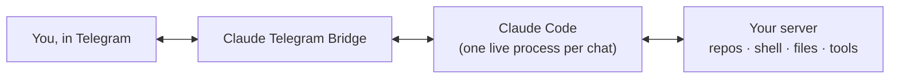

<div align="center">

# Claude Telegram Bridge

**Claude Code on your server, with Telegram as the remote control.**

[Install](#install-in-three-steps) · [Commands](#commands) · [Permission modes](#permission-modes) · [Several users](#letting-other-people-in) · [With other Telegram AI parts](#together-with-the-rest-of-telegram-ai) · [Troubleshooting](#troubleshooting)

Part of **[Telegram AI](https://github.com/maleon17/telegram-ai)** — Claude Code and Codex from Telegram, on your own subscription.

</div>

---

You write to a bot; Claude Code works on the machine where your projects live — with its shell, files and tools — and reports back in the chat. It runs on your Claude subscription (Pro, Max or Team) through the official Claude Code CLI, not on a metered API key.



Each chat keeps one long-lived Claude Code process, so a conversation is a real, resumable session rather than a string of separate requests.

## What you get

- **Real sessions** — `/new`, `/sessions`, `/resume`; sessions survive restarts.
- **Watch it work** — one message is edited live with Claude's current step and tool output; the answer arrives separately.
- **Control from the phone** — model, effort, working folder and how much Claude may do without asking.
- **Approve or deny** — in the stricter modes a risky action waits for your `/approve`.
- **Files both ways** — photos and documents go in; results come back as attachments.
- **Voice messages** — transcribed locally with `faster-whisper` (optional).
- **Several users, fully isolated** — each with their own Claude login, sessions and usage.
- **Safe operations** — `/update` tests a new version before switching to it; restarts wait for running answers.

## Install in three steps

**You need:** a Linux server with `systemd` and Python 3, the [Claude Code CLI](https://claude.com/claude-code), a Claude subscription, and a bot token from [@BotFather](https://t.me/BotFather). Your numeric Telegram ID comes from [@userinfobot](https://t.me/userinfobot).

**1. Install the bot:**

```bash
git clone https://github.com/maleon17/claude-telegram-bridge.git
cd claude-telegram-bridge
./setup.sh
```

The installer checks your bot token with Telegram, asks for your Telegram ID and a service name, then installs and starts a systemd service. The token goes to `bridge.env` (mode `600`), never into the unit file. Re-running it is safe: an empty answer keeps the current value.

**2. Log in from Telegram.** Send any message to your bot. It answers with a login button: authorise Claude in the browser and paste the code back into the chat. Each chat has its own login — the bridge never touches the one in `~/.claude`.

**3. Start working.** Ask for something. Sending `/mode` first is a good idea: see [Permission modes](#permission-modes).

## Commands

| Command | What it does |
|---|---|
| `/new` | Start a new session |
| `/sessions` · `/resume <id>` | List recent sessions · continue one (ID or prefix) |
| `/status` | Session, model, mode, working folder, busy state |
| `/stop` | Interrupt the current work |
| `/compact` | Compact the current session's context |
| `/usage` | Tokens, cost and your account's limits |
| `/model [model]` | Show or choose the model: full ID or a short name like `opus`, `sonnet`, `default` |
| `/effort [level]` | Show or choose reasoning effort |
| `/mode <mode>` | Choose a [permission mode](#permission-modes) |
| `/approve` · `/approve session` · `/deny` | Allow one blocked action · allow for the rest of the session · refuse |
| `/workspace <path>` | Change the working folder |
| `/language en\|ru\|uk\|kk\|de` | Interface and persona language for this chat |
| `/voicelang uk\|ru\|en\|auto` | Language for voice-message transcription |
| `/persona` · `/persona reset` | Owner only: show or reset this chat's persona |
| `/login` | Log in again (for example after the session expired) |
| `/restart` · `/update` | Owner only: safe restart · tested update from Git and restart |

## Permission modes

| Mode | Claude may… |
|---|---|
| `plan` | only read and plan — nothing is changed |
| `default` | read freely; anything risky waits for `/approve` |
| `acceptEdits` | edit files without asking; other risky actions wait for `/approve` |
| `bypass` | do anything without asking (`--dangerously-skip-permissions`) |

`bypass` is convenient precisely because humans apparently enjoy giving autonomous software shell access at 2 AM. Use it only in trusted chats on a host you can afford to lose.

## Letting other people in

Put their numeric Telegram IDs into `whitelist.txt` (one per line or comma-separated) — no restart needed. On their first message they get the same login button and connect **their own** Claude subscription; nobody shares your billing, sessions or context.

Every chat lives in `accounts/<chat_id>/`. On your own first use, your existing persona (`~/.claude/CLAUDE.md`), MCP servers and past sessions are copied in — your credentials are not. Removing an ID blocks new messages; their data stays on disk until you delete it.

> **Security:** all users share the service's Linux user, and `bypass` gives Claude everything that user can do. Whitelist only people you trust; use separate Linux users or containers if you need hard isolation.

## Together with the rest of Telegram AI

The bridge is complete on its own. When other parts of [Telegram AI](https://github.com/maleon17/telegram-ai) are installed **on the same server**, they find each other automatically (each `setup.sh` records itself in a small registry under `~/.config/telegram-ai/`):

| Installed alongside | What it adds |
|---|---|
| **[Codex Telegram Bridge](https://github.com/maleon17/codex-telegram-bridge)** | Claude gets a `delegate_to_codex` tool: ask it to "check this with Codex", and it hands the task to Codex for the same Telegram user, waits for the answer and continues with it. That user needs an account on the Codex bot too. |
| **[ClaudeAsk](https://github.com/maleon17/claude-ask)** / **[CodexAsk](https://github.com/maleon17/codex-ask)** | If you own a userbot instance, Claude in *your* chat can act in your Telegram account: send messages, read a chat's history, manage groups and triggers. Nobody gets another person's account. The userbot assistant can also hand tasks to this bridge and get the answer back. |

Changes in who owns which userbot are picked up on the next restart.

## Troubleshooting

| Symptom | What to check |
|---|---|
| The bot is silent | `journalctl -u claude-telegram-bridge -f`. A mistyped token shows up as repeated `getUpdates not ok`. |
| "Not logged in" | Send `/login` — each chat has its own Claude login |
| A login seems stuck | Send `/login` again; it restarts the flow |
| `/restart` fails | The sudoers rule `setup.sh` installed must match the service name, including `.service` |
| Odd formatting in the process log | Try Telegram's default theme; some custom themes render code blocks poorly |

## Operations

```bash
systemctl status claude-telegram-bridge    # is it running?
journalctl -u claude-telegram-bridge -f    # live log
./update.sh                                # tested update from Git (then /restart)
scripts/run_tests.sh                       # test suite
```

`/update` does the same from Telegram: it checks the new version in a temporary worktree, switches only if the tests pass, and restarts once running answers are delivered.

<details>
<summary><b>Large files: optional local Bot API server</b></summary>

Telegram's cloud Bot API limits bots to 20 MB downloads and 50 MB uploads. If you allowed it during `setup.sh`, `/update` can build Telegram's official [`telegram-bot-api --local`](https://github.com/tdlib/telegram-bot-api) server (loopback only, shared by all bots on the machine), which lifts the download limit and allows uploads up to 2,000 MB. It asks for `api_id`/`api_hash` from [my.telegram.org](https://my.telegram.org) in the chat and keeps them only in a mode-`600` file. Preview the installer without changing anything:

```bash
scripts/install-local-bot-api.sh --dry-run
```

Switching logs the bot out of the cloud API, which cannot be undone for about 10 minutes.

</details>

<details>
<summary><b>Delegating from scripts (<code>bridge_exec.py</code>)</b></summary>

`bridge_exec.py "<task>"` gives a task to the running bridge without going through Telegram and prints the final answer — handy for other agents or cron jobs on the same server. Owner only. Options: `--workspace`, `--resume <session>`, `--model`, `--effort`, `--timeout`, `--env KEY=VALUE` (a secret for this one turn only). The answer also appears in your chat, with a note on how to return to your own session.

</details>

<details>
<summary><b>Manual install and settings</b></summary>

Create `bridge.env` with mode `600`:

```dotenv
TELEGRAM_BOT_TOKEN=<token>
OWNER_ID=<numeric Telegram ID>
SERVICE_NAME=claude-telegram-bridge.service
CLAUDE_BIN=<path to claude>
```

Copy `claude-telegram-bridge.service.example` to `/etc/systemd/system/claude-telegram-bridge.service`, replace `__USER__`, `__HOME__`, `__INSTALL_DIR__`, `__ENV_FILE__` (absolute path to `bridge.env`) and `__PYTHON__` (`/usr/bin/python3`), then `sudo systemctl daemon-reload && sudo systemctl enable --now claude-telegram-bridge`.

`/restart` and `/update` need exactly one sudo rule (validate with `visudo -cf` before installing):

```text
<user> ALL=(root) NOPASSWD: /usr/bin/systemctl restart claude-telegram-bridge.service
```

Optional `bridge.env` keys: `TELEGRAM_API_URL` (local Bot API), `BRIDGE_WORKDIR` (default working folder, your home by default), `CODEX_TELEGRAM_BRIDGE_DIR` (if the Codex bridge is not found automatically).

Unattended install: every `setup.sh` question can be answered through the environment — `BOT_TOKEN`, `OWNER_ID`, `SERVICE_NAME`, `LOCAL_BOT_API_SETUP=y|n`, `INSTALL_VOICE=y|n`, `ASSUME_YES=1`.

The test suite runs extra cross-project checks when `~/telegram-ai-core`, `~/claude-jarvis` and `~/codex-jarvis` exist (override with `TELEGRAM_AI_CORE_DIR`, `CLAUDE_JARVIS_DIR`, `CODEX_JARVIS_DIR`) and skips them otherwise.

</details>

## License

MIT, see [LICENSE](LICENSE). `telegram_format.py` is adapted from [hermes-agent](https://github.com/NousResearch/hermes-agent) (MIT, Copyright (c) 2025 Nous Research).
