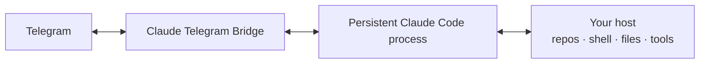

# Claude Telegram Bridge

> Part of **[Telegram AI](https://github.com/maleon17/telegram-ai)** — persistent Claude Code and Codex workflows controlled from Telegram.

**Claude Code on your server, with Telegram as the remote control.**

This bridge keeps a real Claude Code session running behind a Telegram bot. It does not turn each Telegram message into an isolated API request: conversations are resumable, tool activity is visible while Claude works, files travel both ways, and model/workspace/permission controls are available from the phone.

It maintains one `claude -p --input-format=stream-json --output-format=stream-json` process per active chat. A process is respawned with `--resume` after a model, effort, mode or workspace change, an explicit session switch, or a long idle period.

It uses your existing Claude subscription through the installed Claude Code CLI rather than a metered API key.

## Why a persistent bridge?



The important part is where Claude lives: **on the machine that has the project**. Telegram is only the human control surface.

A session can survive bot restarts, be resumed later by ID, expose live progress while tools run, accept files from Telegram, and return generated artifacts without requiring you to sit at an SSH terminal.

## Highlights

- **Live progress** — one Telegram message is edited while Claude works, showing current thought/tool activity and results; the final answer is delivered separately.
- **Native persistent sessions** — `/new`, `/sessions`, and `/resume` use Claude Code's session mechanism.
- **Remote runtime controls** — change model, effort, workspace and permission mode from Telegram.
- **Human approval loop** — permission modes range from read-only planning to explicit approve/deny gates and full bypass.
- **Files in both directions** — incoming photos/documents are passed to Claude; generated files can be returned automatically or explicitly through `send_telegram_file`.
- **Multi-account isolation** — every chat, including the owner, has its own `CLAUDE_CONFIG_DIR`, sessions and usage; additional users authenticate their own Claude subscription.
- **Safe operations** — updates are tested before fast-forwarding and restarts are deferred until active work finishes.
- **Message resilience** — forwarded batches are combined, Telegram rich messages are converted to Markdown, long answers are split, and failed Telegram deliveries can be retried.
- **Voice messages** — optional `faster-whisper` transcribes incoming audio; without it, the bot explains that transcription is unavailable.

## Requirements

- Linux host with `python3` (the bridge itself uses only the standard library)
- [Claude Code CLI](https://claude.com/claude-code), authenticated with a Claude subscription
- Telegram bot token from [@BotFather](https://t.me/BotFather)
- `systemd` for the supplied service/install workflow
- Optional [`faster-whisper`](https://github.com/SYSTRAN/faster-whisper) for voice transcription

## Quick start

```bash
claude auth login --claudeai

git clone https://github.com/maleon17/claude-telegram-bridge.git
cd claude-telegram-bridge
./setup.sh
```

The installer asks for the bot token, Telegram owner ID and service name.

## Commands

| Command | What it does |
|---|---|
| `/language en\|ru\|uk\|kk\|de` | Set the chat's interface and persona language; update the Telegram command menu |
| `/persona` / `/persona reset` | Owner-only: show or reset the chat persona |
| `/new` | Start a new session |
| `/sessions` | List recent sessions |
| `/resume <id>` | Resume a session by ID/prefix |
| `/status` | Show session, model, mode, workspace and busy state |
| `/stop` | Interrupt current work |
| `/compact` | Compact the current session context |
| `/usage` | Show tokens, cost and account rate limits |
| `/model [model]` | Show/select Claude model by full ID or short form such as `opus`, `sonnet` or `default` |
| `/effort [level]` | Show/select reasoning effort |
| `/mode <mode>` | Select permission mode |
| `/workspace <path>` | Change working directory |
| `/approve` / `/approve session` | Approve one blocked tool call or bypass for the session |
| `/deny` | Reject a blocked tool call |
| `/login` | Authenticate/re-authenticate the Claude account |
| `/restart` | Owner-only deferred restart |
| `/update` | Owner-only tested update followed by deferred restart |

## Permission modes

- `bypass` — no confirmation prompts; equivalent to `--dangerously-skip-permissions`.
- `default` — dangerous tool calls require `/approve`.
- `acceptEdits` — file edits are approved automatically; other protected actions still require approval.
- `plan` — read-only planning.

`bypass` is convenient precisely because humans apparently enjoy giving autonomous software shell access at 2 AM. Use it only for trusted chats and hosts.

## Multi-account isolation

`whitelist.txt` controls who may use the bridge and is re-read for every message. Every chat receives isolated account state under `accounts/<chat_id>/`. The owner's account is migrated from the existing Claude configuration on first use; additional users authenticate through their own `claude auth login` flow.

Additional users get their own subscription, sessions and usage rather than sharing the owner's billing or context. The owner can also re-authenticate through `/login` in Telegram.

To add someone, put their numeric Telegram ID in `whitelist.txt` (comma or newline separated). They then message the bot and follow its login button, authorize their Claude account in a browser, and paste the resulting code back into that chat. The whitelist is checked again on their next message, so no service restart is required.

Removing a user from the whitelist blocks new requests; account data remains on disk until deliberately removed.

## Files and Telegram delivery

Incoming Telegram photos and documents are downloaded and made available to Claude.

For outgoing artifacts, the bridge can automatically send files Claude writes or names in its final response. Claude can also explicitly call the tenant-scoped `send_telegram_file` tool; that tool accepts files only from the chat's `CLAUDE_TELEGRAM_OUTBOX`. Because automatic delivery can use paths outside that outbox, grant bridge access only to trusted chats and hosts.

## Updating safely

`/update` and `./update.sh` fetch the tracked branch, check the candidate revision in a temporary worktree and run:

```bash
scripts/run_tests.sh
```

The active checkout is fast-forwarded only when checks pass. Bot-triggered updates then schedule a deferred restart after active turns and queued messages finish. `./update.sh` alone does not restart the service; follow it with `/restart`.

## Manual install

Create `bridge.env` with mode `600`:

```dotenv
TELEGRAM_BOT_TOKEN=<token>
OWNER_ID=<numeric Telegram ID>
SERVICE_NAME=claude-telegram-bridge.service
CLAUDE_BIN=<path to claude>
```

Copy `claude-telegram-bridge.service.example` to `/etc/systemd/system/claude-telegram-bridge.service` and replace `__USER__`, `__HOME__`, `__INSTALL_DIR__` and `__ENV_FILE__` (the absolute path to `bridge.env`). For `/restart` and `/update`, allow only this sudoers command:

```text
<user> ALL=(root) NOPASSWD: /usr/bin/systemctl restart claude-telegram-bridge.service
```

Validate the sudoers file with `visudo -cf` before installing it.

Then:

```bash
sudo systemctl daemon-reload
sudo systemctl enable --now claude-telegram-bridge.service
```

## Tests

```bash
scripts/run_tests.sh
```

The suite byte-compiles modules and runs `breaker_tests/test_*.py`. Optional sibling-repository integration checks look for `~/claude-jarvis` and `~/codex-jarvis` (override with `CLAUDE_JARVIS_DIR` and `CODEX_JARVIS_DIR`) and report `SKIP` when those checkouts are absent.

## Troubleshooting

- **Bot is silent:** inspect `journalctl -u <service-name> -f` and verify `claude auth status`.
- **Missing `OWNER_ID` / `TELEGRAM_BOT_TOKEN`:** check `bridge.env` and the unit's `EnvironmentFile=`.
- **`/restart` fails:** verify the sudoers rule matches `SERVICE_NAME`, including `.service`.
- **A user's login is stuck:** check for an old `claude auth login` process; `/login` can start the flow again.
- **Process-log formatting looks wrong:** test with Telegram's default theme; custom themes may render preformatted blocks differently.

## Ecosystem

Want Codex instead, or an agent callable inline from your own Telegram account? See the **[Telegram AI hub](https://github.com/maleon17/telegram-ai)**.

## License

MIT, see [LICENSE](LICENSE).

`telegram_format.py` is adapted from [hermes-agent](https://github.com/NousResearch/hermes-agent) (MIT License, Copyright (c) 2025 Nous Research); see its file header for attribution.
